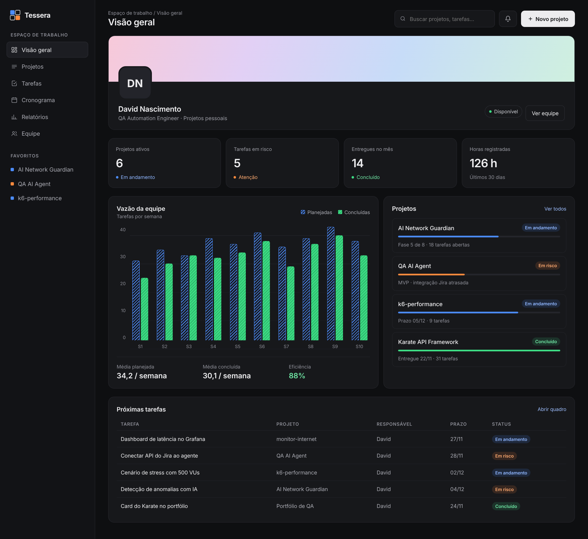
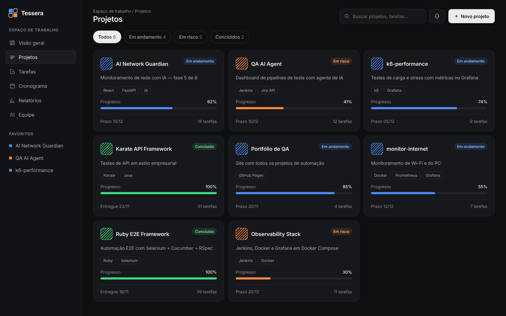
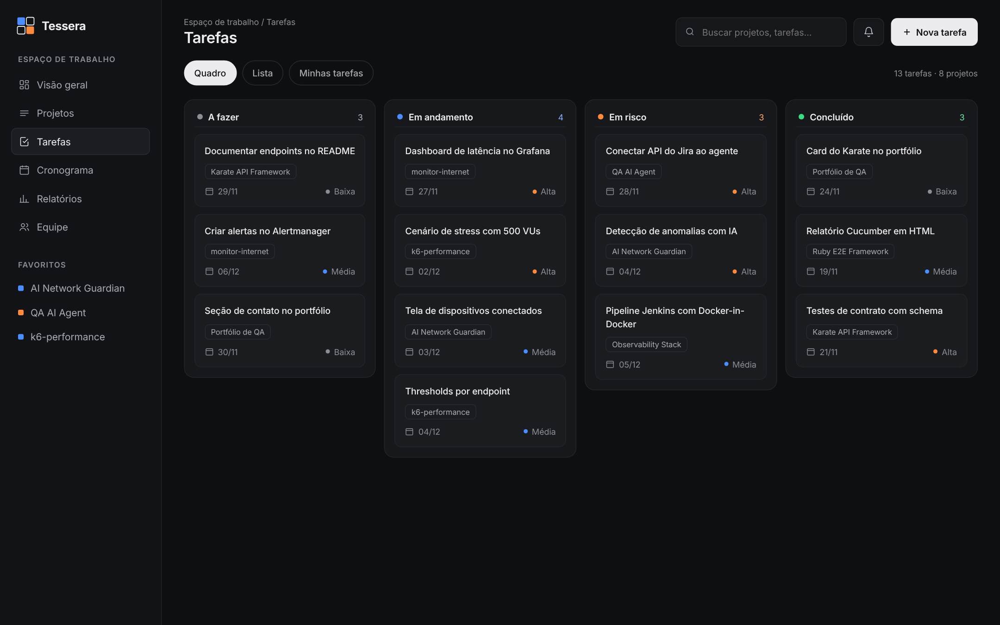
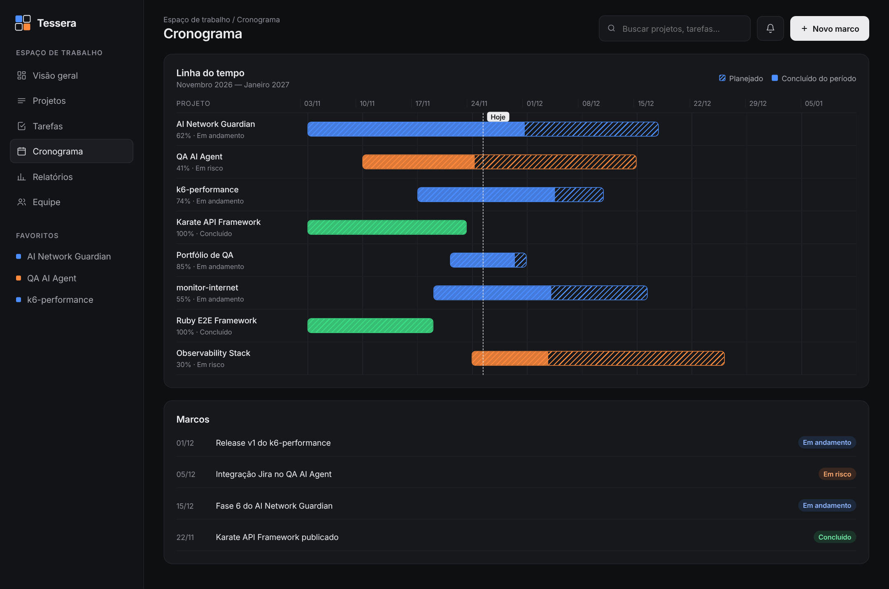
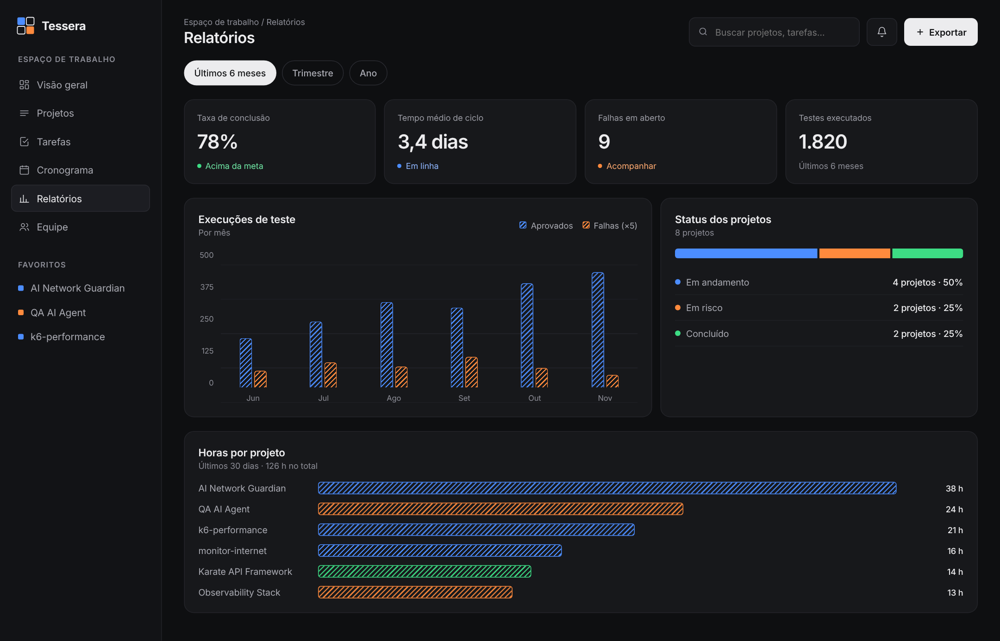
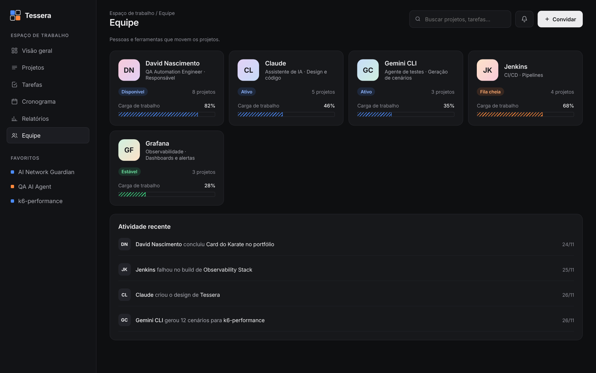
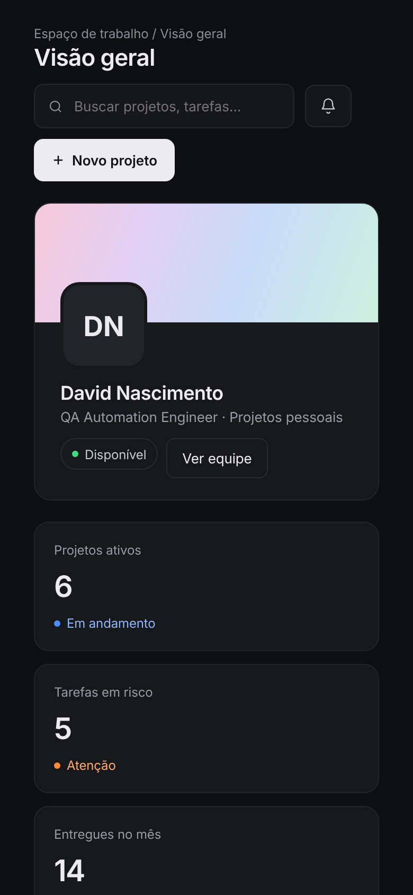

<div align="center">

# Tessera

**Painel de gerenciamento de projetos em modo escuro: portfólio visual de UI**

Superfícies em carvão · bordas finíssimas · gráficos com hachuras · banner em gradiente pastel · Inter · status em azul, laranja e verde

[**Ver online**](https://david-nascimento.github.io/Tessera/) · [Telas](#telas) · [Design](#sistema-visual) · [Como rodar](#como-rodar)



</div>

---

## Sobre

O **Tessera** é um conceito de painel para acompanhar projetos, tarefas, prazos e equipe. É um **portfólio visual**: as telas são HTML e CSS estáticos, sem backend. Os dados de exemplo usam meus próprios projetos de QA e automação (AI Network Guardian, QA AI Agent, k6-performance, Karate API Framework…). **Números, datas e percentuais são ilustrativos.**

São seis telas navegáveis pela barra lateral:

| Tela | O que mostra |
| --- | --- |
| **Visão geral** | Banner de perfil, indicadores, vazão semanal (planejado × concluído), projetos e próximas tarefas |
| **Projetos** | Cartões com status, descrição, tecnologias, progresso e prazo, com filtros por status |
| **Tarefas** | Quadro kanban: A fazer, Em andamento, Em risco e Concluído, com prioridade e prazo |
| **Cronograma** | Linha do tempo (Gantt) com barras hachuradas para o planejado, preenchimento para o concluído, marcador de "Hoje" e marcos |
| **Relatórios** | Indicadores, execuções de teste por mês, distribuição de status e horas por projeto |
| **Equipe** | Pessoas e ferramentas (IA, CI/CD, observabilidade) com carga de trabalho e atividade recente |

## Telas

### Visão geral


### Projetos


### Tarefas


### Cronograma


### Relatórios


### Equipe


### Celular
O layout é fluido: em telas estreitas a barra lateral vai para o topo, os cartões empilham e as tabelas ganham rolagem horizontal.



## Sistema visual

| Token | Valor | Uso |
| --- | --- | --- |
| Fundo | `#0E0F11` | Página |
| Barra lateral | `#121316` | Navegação |
| Superfície | `#17181B` | Cartões e seções |
| Borda | `#24252A` | Borda de 1px dos cartões |
| Texto | `#ECECEE` | Texto principal |
| Texto secundário | `#8C8D96` / `#A9AAB2` | Rótulos e metadados |
| Azul | `#4C8DFF` | Em andamento / planejado |
| Laranja | `#FF8A3D` | Em risco / falhas |
| Verde | `#3DDC84` | Concluído |

- **Tipografia:** [Inter](https://fonts.google.com/specimen/Inter) (400, 500, 600, 700) com espaçamento levemente negativo nos títulos.
- **Hachuras:** feitas só com CSS (`repeating-linear-gradient(135deg, …)`), sem imagens nem bibliotecas de gráfico.
- **Banner:** gradiente pastel rosa → lilás → azul → menta.
- **Ícones:** SVG em traço, desenhados inline.
- **Acessibilidade:** `<nav>`, `<main>` e `<button>` semânticos, `aria-label` nos botões só com ícone, `aria-current` na aba ativa e contraste de texto acima de 4.5:1 sobre as superfícies escuras.

## Estrutura

```
Tessera/
├── docs/                  # site estático (publicado no GitHub Pages)
│   ├── index.html         # Visão geral
│   ├── projetos.html
│   ├── tarefas.html
│   ├── cronograma.html
│   ├── relatorios.html
│   ├── equipe.html
│   └── screenshots/       # imagens usadas neste README
└── scripts/
    ├── build.py           # gera as páginas a partir dos tokens e dados
    └── screenshots.py     # gera as capturas com Playwright
```

As páginas são geradas por `scripts/build.py`. Os tokens de cor, os componentes (barra lateral, topo, cartões, pills de status, barras hachuradas) e os dados de exemplo ficam num só lugar, e todas as telas saem consistentes.

## Como rodar

Não precisa instalar nada para ver: abra `docs/index.html` no navegador.

Para gerar de novo as páginas e as imagens:

```bash
# páginas
python scripts/build.py

# capturas de tela (opcional)
pip install playwright
playwright install chromium
python scripts/screenshots.py
```

Para servir localmente:

```bash
python -m http.server 8000 --directory docs
# http://localhost:8000
```

### GitHub Pages

Em **Settings → Pages**, escolha **Deploy from a branch**, branch `main` e pasta `/docs`. O site fica em `https://david-nascimento.github.io/Tessera/`.

## Próximos passos

- [ ] Versão em React + TypeScript com componentes reutilizáveis
- [ ] Dados vindos de uma API (FastAPI) ou do Jira
- [ ] Filtros e quadro kanban funcionais
- [ ] Tema claro

## Autor

**David Nascimento**, QA Automation Engineer
[GitHub](https://github.com/David-Nascimento) · [Portfólio](https://david-nascimento.github.io/qa-automation-portfolio/)

Licença [MIT](LICENSE).
